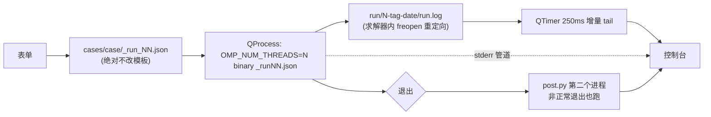

# gui — PurineCFD-R2 图形运行台（PySide6）

## 启动

```bash
./gui.sh
```

手动等价写法：

```bash
cd /home/purine/PurineCFD-R2
uv run --with pyside6 python gui/main.py
```

`gui.sh` 会自己 `cd` 到仓库根目录，并在 `DISPLAY` / `WAYLAND_DISPLAY` 都为空时报错退出。

唯一的依赖是 PySide6，已在根目录 [pyproject.toml](../pyproject.toml) 的 `[dependency-groups]`
里声明，并被列入 `[tool.uv] default-groups`。所以装环境只要在仓库根目录跑一条：

```bash
uv sync          # 一次性装齐 post / anim / gui / dev 四组
./gui.sh
```

`gui.sh` 用的是 `uv run --with pyside6` 这种临时拉取方式，好处是完全不动 `.venv`、拿到仓库就能跑。

WSLg 已就绪（`DISPLAY=:0`、`WAYLAND_DISPLAY=wayland-0`），Qt 走 Wayland 平台插件，
窗口直接出现在 Windows 桌面上。实测 `QApplication.platformName() == 'wayland'`。
WSL 发行版默认不带中文字体，`main.py` 启动时会从 `/mnt/c/Windows/Fonts/` 挂一个（找不到会提示
`sudo apt install fonts-noto-cjk`），否则界面上的汉字会显示成方框。

## 界面

六个选项卡，按操作顺序排：**① 算例 → ② 来流 → ③ 求解 → ④ 后处理 → ⑤ 运行 → ⑥ 控制台**。

| 选项卡 | 内容 |
|---|---|
| ① 算例 | 算例下拉（cylinder / naca0012 / oat15a）、配置模板下拉（第一项恒为「（内置默认）」，其后自动扫 `cases/<case>/*.json`，只列含 `io`/`solver`/`farfield` 三节的）、网格文件、结构化邻接表（可留空）、起始流场（可留空）、输出目录（开跑后自动填） |
| ② 来流 | Ma、Re、静温 T、参考长度 L、攻角 α；下方派生量 μ / a / U∞ / ρ∞ / p∞ / q∞，随输入实时刷新 |
| ③ 求解 | **表单，不暴露 JSON**。字段由所选模板的 `solver` 段动态生成：整数 → 计数框，小数 → 数字框，布尔 → 勾选框；`urans` 子节单独一组（该模板没有 `urans` 时整组隐藏）。行标签用中文（见 `FIELD_LABELS`），鼠标悬停在控件上显示原始键名 |
| ④ 后处理 | 曲线/统计 7 项 + 云图面板 9 项（带全选/全不选）、探针位置 x/c、u 色标、历史段 |
| ⑤ 运行 | 可执行文件路径（记忆上次）、跑完自动后处理（默认勾）、生成配置 JSON、自动测线程数、开始运行 / 仅跑后处理 / 停止 |
| ⑥ 控制台 | 深色等宽，求解器日志 + stderr + 后处理输出 |

进度条与状态行固定在选项卡下方，切到任何页都看得见。点「开始运行」会自动跳到 ⑥。

正文 17px / 中等字重；数字框与下拉框**不响应鼠标滚轮**（`Spin` / `DSpin` / `Combo` 三个子类
吞掉 `wheelEvent`），避免滚动页面时误改参数。

**③ 的取值保证无损**：表单起点是模板的 `solver` 字典，只覆盖渲染出来的键，
未渲染的键原样保留；读回后与模板 `==` 相等（已对 3 个算例共 11 个模板逐一验证）。

配色为浅色卡片风格，样式集中在 `gui/main.py` 的 `STYLE` 常量；
勾选框与下拉箭头用 `gui/check.svg`、`gui/down.svg` 两个矢量图标（QSS 画不出旋转的勾）。

## 没有模板 JSON 也能开跑

① 页模板下拉的第一项是「（内置默认）」，对应 `gui/runner.py` 的 `builtin_template()`，
所以 `cases/<case>/` 下即使一个配置文件都没有（或全被 `_` 开头过滤掉），界面依然完整可用：

- `solver` 段用 `DEFAULT_SOLVER` 兜底，键名与取值范围严格按 `src/io.hpp` 的白名单与校验（正整数、
  `Ma < 1`、`|α| < 90°`……）；`convergence_interval` / `urans.wall_interval` 这类必须为正的键，
  控件下限已相应提高（`MIN_POSITIVE`），避免滑到 0 生成非法配置
- `farfield.p` 由 `Ma / Re / T / L` 经 Sutherland 反算得到（默认 `Ma=0.2`、`Re=1000`、`T=300 K`），
  因此界面里的 Re 显示为 1000 本身，而不是 0
- `io` 三个路径在写配置时一律被重写成真实 run 目录，模板里留空即可
- 网格与结构化邻接表需要自己点「选择」，空模板不猜路径

## 自动测线程数

线程数会**改变迭代算子本身**：`src/dualtime.hpp::block_sgs` 按 `lo = cell·tid/nt`、
`hi = cell·(tid+1)/nt` 切块，核越多块越小、块间耦合越弱，因此「跑得最快」与「残差降得最多」
未必是同一档。⑤ 页的「自动测线程数」就是为了拿本机数据回答这个问题：

- 候选为 ≤ 本机核心数的 `4/8/16/32/64/96/128`（`runner.thread_candidates()`）
- 每档写一份临时配置 `cases/<case>/_run_bench_<N>.json`：`max_steps=1`、`dump_interval=1000`、
  `steady_iters=25`（`runner.BENCH_ITERS`）、`steady_cfl=50`、去掉 `wall_interval`；
  `threads` 同时写进配置并用 `OMP_NUM_THREADS` 指定（后者优先，见 `src/parallel.hpp`）
- 所有输出只落在 `run/_bench/`（名字不含数字前缀，不会被当成正式 run 编号），测完即删；
  **绝不触碰正式 run 目录**
- 首档重复跑一次作预热并丢弃，排除首次执行的文件缓存建页开销
- 每档记录壁钟与日志里最后一条 `steady ... res`（`runner.last_steady_res`），结果同时打印到 ⑥
  和 ⑤ 页按钮下方，并把「最快」的那档写回 ③ 的线程数控件

代价：每档要付一次网格读入 + 25 步定常预热。圆柱（2.4 万单元）约 4 s/档，OAT15A 明显更久。

## 从中间流场启动（续算）

① 页的「起始流场 (可选)」填一个 `step_*.dat`（文件选择框默认从 `run/` 开始），会写进配置的 `io.restart`：

- 留空 = 从自由来流初始化，与旧行为完全一致
- 求解器会接着文件里的步号往下算，`history.csv`、`step_*.dat` 的编号都是绝对量
- ③ 页的步数框叫「结束步号」，就是**终点步号**：起始流场是 1250 步、填 2000，就只再跑 750 步。
  界面写出去的是 `end_step`；从老模板（`max_steps`）读进来时按等价换算显示
- 文件里的 `x,y` 与网格逐格核对，对不上会直接报错退出
- 选了带 `restart` 的模板会把它带进界面；切算例/切模板会重新读
- 想接着算瞬态要先关掉定常预热：`steady_iters` 和 `wall_interval` 这两个框**填 0 表示不写进 JSON**
  （`io.hpp` 的 `count()` 只收正整数，写 0 反而非法），C++ 侧默认就是关的
- 「自动测线程数」也会带上这个起始流场，保证各档线程数从同一个初场出发
- 「开始运行」的确认框会把「步号 / dt」列成 `1251 → 2000  共 750 步`，进度条也按绝对步号走

每次求解退出后，控制台会直接把最新场文件的路径打出来，并提示填到 ① 页就能接着算：

```
[求解器退出] exit code = 0, 壁钟 19.9 s
[续算] 最新流场 run/25-oat-a37-.../step_001500.dat
       填到 ① 页「起始流场」即可接着这个流场算
```

## 停止与崩溃时的数据保全

「停止」（以及关闭窗口）走的是 `QProcess::terminate()`（SIGTERM），**不是** `kill()`：

- 求解器在物理步之间收到信号，会先把**当前这一步**算完、写下 `step_%06d.dat`、关好 `history.csv`，
  再以 0 退出，日志里会看到 `用户中断: 已保存 step N 的流场到 ...`
- 30 秒（关闭窗口时 15 秒）无响应才强杀；圆柱一步约 0.4 s，OAT15A 约 3.5 s，正常都来得及
- 求解器因坏单元判定发散时，回退到上一个有效流场后也会先写盘再以 1 退出
- 停止后如果 ⑤ 页勾了「跑完自动后处理」，仍然会跑后处理（此时 `history.csv` 是截断的，
  `post.py` 会按最后一步出统计）

注意 `terminate()` 只对**子进程**有效，所以别用任务管理器式的强杀（SIGKILL）去中止求解器，那样什么都不会保存。

## 生成配置 JSON

⑤ 运行页的按钮只做一件事：按当前界面信息写出 `cases/<case>/_run_<NN>.json`，并把内容打到 ⑥。
不启动求解器、不重载模板、不改动任何字段。

- 首次点击分配 run 编号并创建 `run/<编号>-<标签>-<日期>-<HHMM>/`（配置里的 `io.field` / `io.log`
  要用真实目录名），路径随即显示在 ① 页
- 再次点击**复用同一编号与目录**，只覆盖配置文件，不会一路往后烧编号
- 求解跑完之后、或切换算例之后再点击，才分配新编号
- 「开始运行」复用已生成的编号与目录，不会另开一个

## 后处理目标

「仅跑后处理」未必用当前显示的 run 目录，而是**挑一个真正含求解结果（有 `history.csv`）的目录**：

1. 优先用刚跑完的那个 run（`self.data`）
2. 否则用当前生成配置指向的 run 目录
3. 两个都没有 `history.csv` → 弹窗提示，不启动后处理

所以「跑完 → 又点了生成配置（分到新编号）→ 点仅跑后处理」不会再去啃新开那个空目录，
会回到真正有结果的那个 run，并在 ⑥ 里说明为何换目标。

结构化算例（cylinder / naca0012）的配置若缺 `io.structured`，`post.py` 会打印提示并退回非结构
后端渲染（云图照出，不再抛 `KeyError`）；⑤ 页的确认框也会提醒这一点。

## 运行前确认

点「开始运行」先弹确认框，列出算例 / 网格 / Ma·Re / T·L·α / p∞·U∞ / 步数·dt /
可执行文件 / 线程 / 后处理项，确认后才创建 run 目录，所以取消不会浪费编号。

运行中关闭窗口会弹确认框：求解器是 `QProcess` 子进程，直接关窗会把它一起杀掉。

## 雷诺数换算

输入 `(Ma, Re, T, L)`，按 Sutherland 公式反算静压（与 `cases/cylinder/generate_case.py`
完全同一套公式）：

$$\mu = \mu_0\left(\frac{T}{T_0}\right)^{1.5}\frac{T_0+S}{T+S},\quad
a=\sqrt{\gamma RT},\quad U_\infty = Ma\cdot a,\quad
\rho_\infty=\frac{Re\,\mu}{U_\infty L},\quad p_\infty=\rho_\infty R T$$

常数：$\gamma=1.4$、$R=287.05$、$\mu_0=1.716\times10^{-5}$、$T_0=273.15$、$S=110.4$。

选模板配置时会用模板里的 `p` **反算** Re 填进界面，因此不动任何字段时，生成的配置与模板一致。
（Re 在界面上是整数，回代算出的 p 会有约 1e-7 的相对回差，可忽略。）

## 运行时序



- 求解器与后处理是**先后两个进程**，不是一个
- 求解器 stdout 被 `src/io.hpp::open_log` 的 `freopen` 写进 `run.log`，
  所以 QProcess 的 stdout 管道是空的；控制台靠**轮询读文件**
- `main.cpp` 每个报告行后都 `fflush(stdout)`，所以日志逐行落盘，延迟 ≈ 报告间隔
- `stderr` 未被重定向，走管道直连控制台

## run 编号与目录

沿用既有约定 `run/<编号>-<标签>-<YYYYMMDD>-<HHMM>/`，编号取 `run/` 下现有最大值 +1。

标签：cylinder → `cyc`，naca0012 → `naca-a<Ma…>` 形式见 `runner.tag_of`，oat15a → `oat-a<alpha>`。

临时配置写到 `cases/<case>/_run_<NN>.json`（名称命中 `.gitignore` 已有的 `_run_*.json`，不会被 git 追踪）。

## 后处理复选框与命令行映射

| 复选框 | 传给 post.py |
|---|---|
| 云图面板（9 个） | `--panels u,v,rho,...`；全不勾 = `--panels none` |
| history.png | `--no-history` |
| residual.png | `--no-residual` |
| cp_dist.png | `--no-cp-dist` |
| cp_rms.png/.dat | `--no-cp-rms` |
| 探针 Cp/PSD 组 | `--no-probe` |
| schlieren_sequence.png | `--no-sequence` |
| README.md | `--readme` |
| 探针位置 x/c | `--probe <值>` |
| u 色标 | `--u-positive` / `--u-symmetric` / 不传 |
| phase | `--phase U|S` |
| 壁钟耗时 | `--wall <求解器实耗秒>` |

`--no-*` 全部默认关闭（即默认全输出），所以不带这些开关的旧命令行行为**逐位不变**。
`summary.txt` 与 `history.csv` 始终写出。

## 与手敲命令的等价性

控制台开头会打印等价命令行，可复制到终端复现：

```
$ cd /home/purine/PurineCFD-R2
$ OMP_NUM_THREADS=96 /path/to/binary cases/oat15a/_run23.json
```
